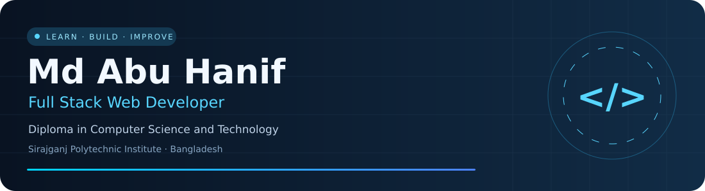
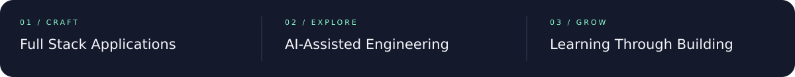
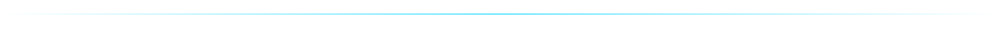
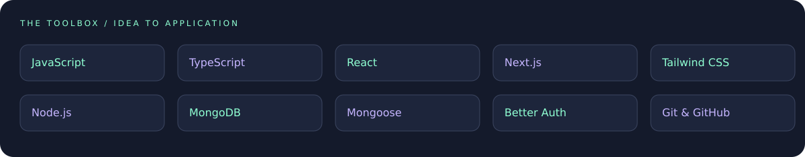
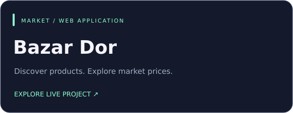
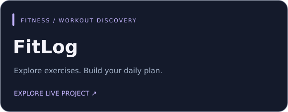
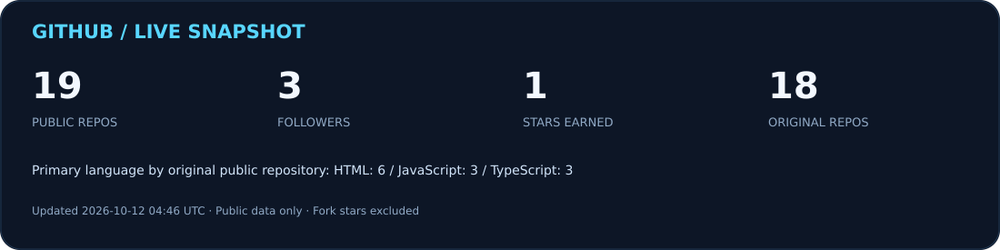

[About](#about-me) · [Skills](#tech-stack) · [Projects](#featured-projects) · [Statistics](#github-statistics) · [Contact](#connect-with-me)

## 01 — About Me

Hi, I’m **Md Abu Hanif**, a **Full Stack Web Developer** based in **Sirajganj, Bangladesh**. I enjoy turning ideas into responsive, practical web applications and strengthening my skills through hands-on projects.

- 🎓 Studying **Diploma in Computer Science and Technology** at **Sirajganj Polytechnic Institute**.
- 💻 Building web applications with **React, Next.js, Node.js, and MongoDB**.
- 🔐 Working with authentication tools including **Better Auth**, **JWT**, and **Firebase Authentication**.
- 🌱 Continuing my studies and exploring **AI Mindset & Engineering** and **AI-Assisted Coding**.
- 🚀 Featured work: **Bazar Dor** and **FitLog**.
- 🤝 Open to learning opportunities and project collaboration.

> “Code with curiosity. Grow with practice.”

## 02 — Connect With Me

**Email:** [mhabuhanif230@gmail.com](mailto:mhabuhanif230@gmail.com)  
**Location:** Sirajganj, Bangladesh

## 03 — Tech Stack

| Category | Technologies |
|:--|:--|
| **Frontend** | HTML5 · CSS3 · JavaScript · TypeScript · React · Next.js · Tailwind CSS |
| **Backend** | Node.js · Express.js · Mongoose |
| **Database** | MongoDB · Firebase Realtime Database |
| **Authentication** | Better Auth · JWT · Firebase Authentication |
| **CMS** | WordPress · Theme & Plugin Customization · Elementor · WooCommerce |
| **Tools** | Git · GitHub · Figma · VS Code |
| **AI & Engineering** | AI Mindset & Engineering · AI-Assisted Coding |

## 04 — Featured Projects

| Project | Overview | Live Demo |
|:--|:--|:--|
| **Bazar Dor** | A web project focused on browsing market products and prices. | [Explore Bazar Dor ↗](https://bazar-dor-mh.vercel.app/) |
| **FitLog** | A workout discovery app for exploring exercises, saving workouts, and creating a daily training plan. | [Explore FitLog ↗](https://fit-log-ecru-three.vercel.app/) |

[Browse my repositories →](https://github.com/mdabuhanif230?tab=repositories)

## 05 — GitHub Statistics

Generated from public GitHub data and refreshed daily by GitHub Actions. Language counts represent each original public repository’s primary language, not code volume.

**Interested in collaborating? [Let’s connect on LinkedIn](https://www.linkedin.com/in/mdabuhanif230).**

